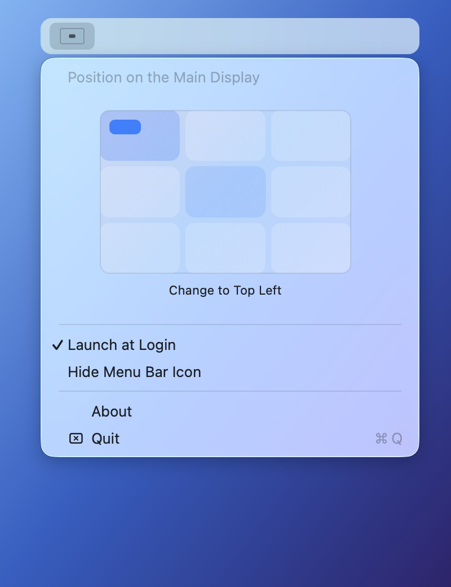
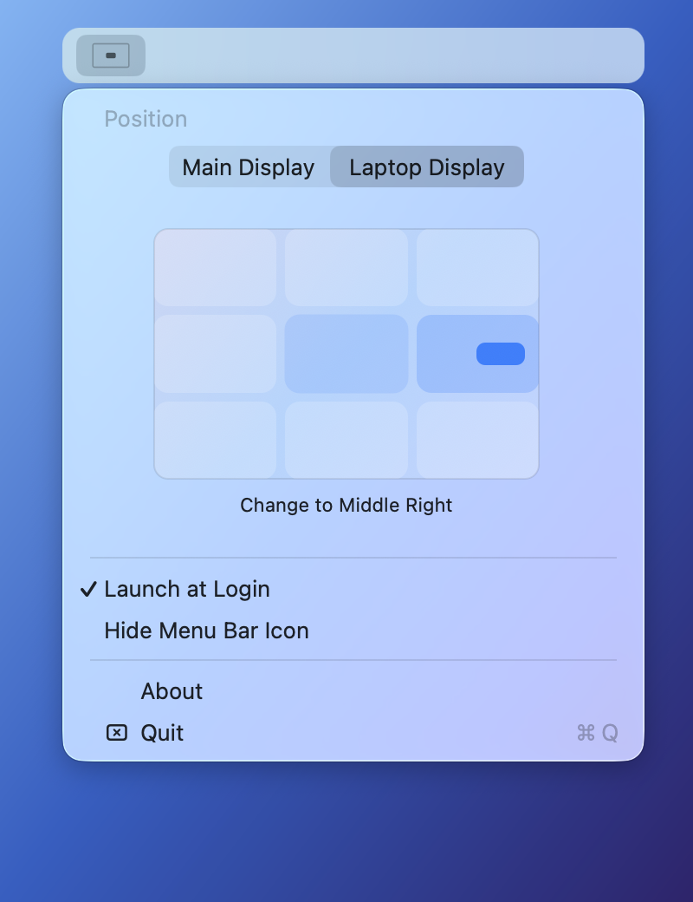

<!-- SPDX-License-Identifier: GPL-3.0-only -->

# NotifyPoint

[](https://github.com/bric3/NotifyPoint/releases/latest)
[](https://github.com/bric3/NotifyPoint/actions/workflows/tests.yml)

NotifyPoint is a macOS menu bar utility that repositions notification banners using
the Accessibility API. Choose one of nine positions on the main display or the
built-in laptop display. The default position is top centre.

The app recalculates placement after display changes and retries detection after
sleep, unlock, or delayed notification delivery. It excludes desktop widgets and
avoids moving the open Notification Center panel.

## Requirements

- macOS 14 or later, on Apple silicon or Intel.
- Accessibility permission for NotifyPoint.
- Xcode Command Line Tools for building from source.

## Installation

Build and install from source:

```sh
git clone https://github.com/bric3/NotifyPoint.git
cd NotifyPoint
make install
```

`make install` builds a universal app, replaces the copy in
`~/Applications/NotifyPoint.app`, and launches it. It stops any running NotifyPoint
instance first. To build without installing, run `make build`; the resulting
bundle is `NotifyPoint.app` in the repository root.

On first launch, grant access in **System Settings > Privacy & Security > Accessibility**,
then reopen NotifyPoint.

> [!NOTE]
> Local builds use ad-hoc signing by default. Rebuilding may require granting
> Accessibility access again. See [code signing](CONTRIBUTING.md#code-signing)
> for a stable local signing identity.

## Usage

Open the menu bar icon and select a zone in the graphical position chooser.
The icon reflects the selected position. On supported laptops, the display
selector offers the main display or the built-in laptop display; if the built-in
display is unavailable, placement falls back to the main display.

Use `Launch at Login` to enable automatic startup. `Hide Menu Bar Icon` keeps the
app running; launch NotifyPoint again to restore the icon.

Position chooser and display selection:




Notification placed at the top left:


## Configuration

Menu selections are saved automatically. Advanced settings use the
`io.github.bric3.notifypoint` preferences domain. Quit and reopen the app after
changing these settings with `defaults`.

| Key                          | Type    | Values or behaviour                                      |
| ---------------------------- | ------- | -------------------------------------------------------- |
| `notificationPosition`       | String  | Position identifier below; defaults to `topMiddle`.      |
| `notificationDisplayTarget`  | String  | `mainDisplay` (default) or `builtInDisplay`.             |
| `debugMode`                  | Boolean | Enable file logging; disabled in regular builds.         |
| `showRerunDetectionMenuItem` | Boolean | Show `Rerun Detection`; hidden in regular builds.        |

Position identifiers correspond to the nine chooser zones:

| Left         | Centre         | Right         |
| ------------ | -------------- | ------------- |
| `topLeft`    | `topMiddle`    | `topRight`    |
| `middleLeft` | `deadCenter`   | `middleRight` |
| `bottomLeft` | `bottomMiddle` | `bottomRight` |

For example, centre notifications on the built-in laptop display:

```sh
defaults write io.github.bric3.notifypoint notificationPosition -string deadCenter
defaults write io.github.bric3.notifypoint notificationDisplayTarget -string builtInDisplay
```

## Troubleshooting

| Symptom                                                    | Action                                                                                                                      |
| ---------------------------------------------------------- | --------------------------------------------------------------------------------------------------------------------------- |
| Notifications stay in the default position.                | Check NotifyPoint's access in System Settings > Privacy & Security > Accessibility, then reopen the app.                    |
| Notifications stop moving after sleep or a display change. | Enable `Rerun Detection` using the command below, reopen the app, and choose it from the menu.                              |
| Accessibility access stops working after rebuilding.       | Reapprove access for the rebuilt app. See [code signing](CONTRIBUTING.md#code-signing) for a stable local signing identity. |
| The menu bar icon is hidden.                               | Launch NotifyPoint again to restore it.                                                                                     |
| The built-in display is unavailable.                       | Placement falls back to the main display. Open the laptop lid and check the display selector.                               |
| A setting changed with `defaults` has no effect.           | Quit and reopen NotifyPoint; preferences are read at launch.                                                                |

To enable the manual recovery menu item:

```sh
defaults write io.github.bric3.notifypoint showRerunDetectionMenuItem -bool true
```

If the problem persists, enable diagnostic logging:

```sh
defaults write io.github.bric3.notifypoint debugMode -bool true
```

Reopen the app, reproduce the issue, and inspect
`~/Library/Logs/NotifyPoint/debug.log`. When [reporting an issue](https://github.com/bric3/NotifyPoint/issues),
include the relevant log excerpt, approximate failure time, display configuration,
and whether manual detection or restarting restored positioning.

Set either Boolean preference above to `false` and reopen the app to disable it.
Debug builds enable logging and the recovery menu item by default.

## Development

See [CONTRIBUTING.md](CONTRIBUTING.md) for tests, menu preview mode, notification
smoke tests, diagnostics, icon generation, and release procedures.
See [CHANGELOG.md](CHANGELOG.md) for changes by version.

## Project history

NotifyPoint is a fork of [PingPlace](https://github.com/NotWadeGrimridge/PingPlace)
1.3.1, incorporating the macOS 26 notification fix from
[sk0gen's fork](https://github.com/sk0gen/PingPlace). It was renamed to NotifyPoint
in 2026. The fork adds display targeting, recovery after sleep and display
changes, a graphical position chooser, and automated behaviour tests.

## License

NotifyPoint fork and later evolutions by bric3.

Original PingPlace app by [Wade Grimridge](https://github.com/NotWadeGrimridge/PingPlace).

Copyright © 2026 Brice Dutheil and Wojciech Gawinski.

Copyright © 2025 Wade Grimridge.

This project is licensed under the GNU General Public License version 3 only.
See [LICENSE](LICENSE).
